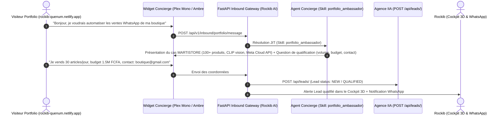
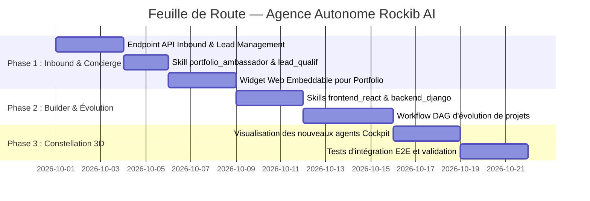

# PRD — STUDIO MULTI-AGENTS AUTONOME & CONCIERGE PORTFOLIO (ROCKIB AI)

> **Document Type** : Product Requirements Document (PRD)  
> **Status** : VALIDÉ / PRÊT POUR CONCEPTION TECHNIQUE  
> **Product Owner** : Rockib agnide Quenum  
> **Author** : Antigravity (Architecte Logiciel IA)  
> **Date** : 28 Septembre 2026  
> **Version** : 1.0.0  

---

## 1. Vision Produit & Objectifs

### 1.1. Thèse Centrale
Faire évoluer **Rockib AI** d'un système d'arbitrage déterministe individuel vers un **Studio d'Agents IA Autonome**, capable de :
1. **Accueillir et qualifier les visiteurs du portfolio personnel 24/7** via un agent Concierge interactif.
2. **Prendre en charge les projets de l'agence**, de la formalisation du besoin jusqu'à l'écriture et l'évolution continue du code source (React, Django, FastAPI).
3. **Opérer sous contrôle déterministe strict** : aucune action engageante (financière, suppression, déploiement critique) ne s'exécute sans l'approbation humaine formelle du propriétaire (Rockib).

### 1.2. Objectifs Métier (KPIs)
- **Taux de capture et qualification des leads** : 100% des messages entrants sur le portfolio sont analysés et classés en moins de 3 secondes.
- **Réduction du temps d'itération projet** : Génération et évolution de fonctionnalités complètes (Frontend React + Backend Django) avec prévisualisation immédiate en direct dans le cockpit.
- **Zéro incident de sécurité** : Respect absolu des invariants de sandboxing (INV-01 à INV-16 et SKILL-INV-01 à 09), aucune fuite entre workspaces clients.

### 1.3. Écosystème Métier Cible : L'Agence « IIA » (`my_agency`)
Le studio multi-agents opère en synergie directe avec la plateforme de production de l'agence **IIA** :
- **Backend IIA (`backend/`)** : Python 5.2 / Django 5.2 / Django REST Framework, SimpleJWT (rotation + blacklist), Celery + Redis, Stripe & FedaPay (Mobile Money XOF).
- **Frontend IIA (`frontend/iia-frontend/`)** : React 19, Vite, React Router v7, React Bootstrap, Framer Motion, Axios avec intercepteur d'auto-refresh token.
- **Portail Client & Paywall (`client_portal/`)** : Modèles `Project`, `ProjectStep`, `Invoice`, `Deliverable` (paywall strict HTTP 402), et webhooks HMAC (`git_webhook`, `stripe_webhook`, `fedapay_webhook`, `deploy_webhook`).
- **Gestion des Prospects (`leads/`)** : Modèle `Lead` (`NEW`, `CONTACTED`, `QUALIFIED`) alimenté directement par notre Concierge Inbound Portfolio.

---

## 2. Architecture de la Constellation d'Agents

Le studio s'organise en 4 rôles spécialisés sous la supervision directe de l'Agent Maître :

```text
                        ROCKIB AGNIDE QUENUM
                     (Master Orchestrator / Toi)
                                 │
         ┌───────────────────────┼───────────────────────┐
         ▼                       ▼                       ▼
   AGENT CONCIERGE         AGENT OPÉRATIONS         AGENT BUILDER & DEV
   (Front-Desk Portfolio)  (Gestion Client/Agence)  (Évolution des Projets)
         │                       │                       │
   - Accueil visiteurs     - Répond aux demandes    - Fait évoluer les apps
   - Qualification leads   - Rédige les briefs      - Code (React / Django)
   - Prise de contact      - Suivi des roadmaps     - Prévisualisation web
         │                       │                       │
         └───────────────────────┼───────────────────────┘
                                 ▼
                         AGENT SENTINELLE
                         (QA & Sécurité)
                         - Audit de code (SAST)
                         - Vérification des tests
                         - Contrôle d'intégrité
```

### Profils Détaillés des Agents

| Agent | Rôle Formel | Mission Principale | Autonomie Défaut | Skills Associés | Outils Typiques |
| :--- | :--- | :--- | :---: | :--- | :--- |
| **Agent Concierge** | `Portfolio Concierge` | Accueil des visiteurs du portfolio, présentation des réalisations, qualification des prospects et capture de contact. | Niveau 1 | `portfolio_ambassador`, `lead_qualification` | `system.read`, `web.search` |
| **Agent Opérations** | `Agency Project Manager` | Prise de brief, structuration des besoins clients en DAG de tâches, planification de roadmap. | Niveau 2 | `agency_operations`, `task_decomposition` | `system.read` |
| **Agent Builder** | `Fullstack Software Engineer`| Conception, génération, écriture et refactorisation de code (React/Vite pour le Front, Django/FastAPI pour le Back). | Niveau 2 | `frontend_react`, `backend_django`, `python_development` | `fs.read`, `fs.write`, `system.create` |
| **Agent Sentinelle** | `Security Sentinel & QA` | Audit de code statique (OWASP), détection de vulnérabilités, vérification des tests et des baux d'exécution. | Niveau 1 | `cybersecurity_defensive`, `system_diagnostics` | `fs.read`, `system.read` |

---

## 3. Le Système Inbound Portfolio (Le Canal d'Accueil)

### 3.1. Composants du Système
1. **Widget Web Embeddable (`rockib-concierge.js`)** :
   - Un composant de chat flottant moderne, responsive et stylisé en parfaite harmonie avec le portfolio live [`rockib-quenum.netlify.app`](https://rockib-quenum.netlify.app/) (fond sombre `#100C08`, typographie `Plex Mono`, accents ambrés `#E8A33D` et touches techniques cyan).
   - Intégrable sur le portfolio via une balise `<script src="https://api.rockib.ai/static/rockib-concierge.js" defer></script>`.
   - Suggestions de questions rapides calibrées sur le portfolio : *"Comment fonctionne le vendeur IA WhatsApp ?"*, *"Voir le portail client de l'Agence IIA"*, *"Parler d'un projet de site ou d'automatisation"*.
2. **API Inbound Sécurisée & Passerelle Leads** :
   - Endpoint : `POST /api/v1/inbound/portfolio/message`.
   - Rate-limiting strict par IP (anti-spam / anti-bruteforce).
   - Transmission automatique vers l'API de l'agence IIA (`POST /api/leads/` dans `my_agency/backend/leads/`) pour persister les coordonnées qualifiées.
3. **Synchronisation Cockpit Temps Réel** :
   - L'arrivée d'un message génère un événement de télémétrie visible dans le Cockpit 3D.
   - Si le prospect formule un projet concret, un `Goal` d'accueil est automatiquement instancié.

### 3.2. Flux Utilisateur (Visitor Journey)



### 3.3. Base de Connaissances du Skill `portfolio_ambassador` (Source Réelle)
Le skill injecte la réalité du terrain de Rockib Quenum :
- **Identité** : Rockib Quenum, Architecte full-stack & automation IA, basé à Cotonou, Bénin.
- **Philosophie & Principes** :
  1. *En production, pas en démo* : Systèmes réels tournant chaque nuit avec du vrai trafic.
  2. *Ownership complet* : De l'architecture multi-agents aux migrations SQL.
  3. *Résilience par défaut* : Files de secours Celery/Redis, bascule automatique entre fournisseurs LLM (Groq/Gemini), coupe-circuits.
  4. *Mesuré et sécurisé* : Audits de cohérence, secrets chiffrés, garde-fous déterministes.
- **Réalisations Réelles** :
  - **MARTISTORE** (`martistore.shop`) : Vendeur IA WhatsApp + boutique complète en ligne (Flask, Celery, PostgreSQL, Meta Cloud API, Groq, CLIP vision).
  - **WaAuto Commercial** (`waauto-commercial.vercel.app`) : Landing d'acquisition, configurateur en 4 écrans, devises dynamiques (FCFA / EUR / USD).
  - **Agence IIA** : Portail client privé (Django, React, FedaPay, Stripe, paywall HTTP 402, webhooks Git/CI-CD).
  - **SaaS multi-boutique** : Plateforme multi-tenant en Docker avec connecteurs Evolution API & Meta Cloud.
- **Coordonnées officielles** : Email `rockibdev@gmail.com`, WhatsApp, GitHub `rockib12`, LinkedIn `rockib-quenum-974471306`.

---

## 4. La Boucle d'Évolution des Projets Clients

### 4.1. Workspace Client Dédié
Chaque projet client possède son propre `workspace_id` hermétiquement isolé :
- Aucun agent travaillant sur le *Projet A* ne peut lire ou modifier les fichiers du *Projet B* (INV-02).
- Le sous-répertoire disque est confiné sous `data/workspaces/{workspace_id}/`.

### 4.2. Cycle Itératif d'Évolution de Code
1. **Instruction d'évolution** (ex: *"Ajouter une page d'authentification avec JWT et un dashboard en mode sombre"*).
2. **Décomposition en Tâches** :
   - Tâche 1 : Schéma de données et endpoint backend (FastAPI/Django).
   - Tâche 2 : Composant React et gestion du state auth (Vite).
   - Tâche 3 : Intégration et validation visuelle.
3. **Exécution Sandlysée & Synthèse** :
   - L'Agent Builder invoque `fs.write` via le handler sécurisé.
   - Les fichiers `App.jsx`, `Auth.jsx`, `api.py` sont générés et validés.
4. **Prévisualisation en Direct** :
   - L'utilisateur ou le client ouvre l'aperçu instantané :  
     `GET /api/v1/workspaces/{workspace_id}/preview/index.html`.
5. **Garde-Fou Déterministe d'Approbation** :
   - Toute modification de schéma de base de données ou action destructive bascule l'Arbitrator en `ControlOutcome.ESCALATE`.
   - Rien n'est livré sans un clic d'approbation sur le bouton d'action du Cockpit.

---

## 5. Matrice de Gouvernance & Moindre Privilège

En application stricte de la spécification [`SKILL_SYSTEM_DESIGN.md`](file:///c:/Users/Priv%C3%A9/Rockib_ia/SKILL_SYSTEM_DESIGN.md) :

```text
SKILL       → Savoir procédural (Comment faire)
TOOL        → Capacité technique (fs.read, fs.write, web.search)
PERMISSION  → Droit serveur (Gouverné par decision_domain_config)
AUTONOMY    → Plafond de liberté (0 = observation, 1-2 = pré-approuvé, 3+ = autonome)
ARBITRATOR  → Verdict d'exécution (ALLOW / DENY / ESCALATE / STOP)
```

### Règles d'Inviolabilité :
1. **L'Agent Concierge ne peut JAMAIS modifier de code** : Ses skills n'embarquent que des outils de lecture (`system.read`, `web.search`). Toute tentative d'écriture est impossible au niveau de sa configuration.
2. **L'Agent Builder ne peut pas contacter les clients en direct** : Il n'a aucun outil réseau externe (pas d'envoi d'email ni d'accès au widget de chat).
3. **Plafonnement d'autonomie parent-enfant** : Tout sous-agent spawnée par l'Agent Builder hérite d'une autonomie $\le 2$ et d'un panier de skills $\subseteq$ à son créateur.

---

## 6. Spécifications des Use Cases Critiques

### UC-01 : Qualification Automatique de Lead Nocturne
- **Déclencheur** : Un visiteur externe envoie un message sur le portfolio en dehors des heures de bureau.
- **Acteur** : Agent Concierge.
- **Déroulement** :
  1. L'agent accueille le visiteur avec une présentation personnalisée.
  2. Il détecte la technologie demandée (ex: React) et cite un projet pertinent du portfolio.
  3. Il demande l'adresse email et le contexte du projet.
  4. Dès réception de l'email, il enregistre le lead et prépare un brief synthétique pour Rockib.
  5. Il remercie le visiteur en indiquant que Rockib le recontactera sous 24h.

### UC-02 : Ajout d'une Fonctionnalité sur Projet Client Existant
- **Déclencheur** : Commande saisie par Rockib dans le CyberTerminal : `mission "Créer le composant de carte produit interactive"`.
- **Acteur** : Agent Builder.
- **Déroulement** :
  1. L'Agent Builder inspecte les fichiers existants via `fs.read`.
  2. Il écrit le nouveau composant React via `fs.write`.
  3. Le système met à jour le statut de la tâche en `COMPLETED`.
  4. Le lien `/preview/index.html` est mis à jour en direct dans le panneau DAG du Cockpit.

### UC-03 : Tentative d'Action Dangereuse (Sécurité & Escalade)
- **Déclencheur** : Une instruction suggère de supprimer une base de données client ou un répertoire entier.
- **Acteur** : N'importe quel sous-agent.
- **Déroulement** :
  1. Le `DomainClassifier` détecte l'action `DELETE`.
  2. Le `DeterministicArbitrator` applique immédiatement `approval_required = True`.
  3. Le verdict est forcé à `ControlOutcome.ESCALATE`.
  4. Aucun appel de connecteur n'est émis (INV-01).
  5. Une alerte rouge s'affiche dans le Cockpit 3D demandant la signature humaine de Rockib.

---

## 7. Exigences Techniques, Performance & Sécurité

### 7.1. Performance & Disponibilité
- **Temps de réponse du Concierge** : $\le 2.0$ secondes pour les réponses du chatbot en streaming via Groq LLM.
- **Persistance transactionnelle** : Tout message, lead ou décision est persisté immédiatement dans PostgreSQL avec identifiant unique (UUID v4).
- **Asynchronisme fiable** : Traitement en arrière-plan des tâches longues par les workers Celery sans blocage de l'API FastAPI.

### 7.2. Sécurité & Confidentialité
- **Protection contre les Injections de Prompt** : Les messages des visiteurs sont encapsulés sous forme de données non exécutables (`User Content`). Aucune instruction visiteur ne peut outrepasser le système d'arbitrage.
- **Sandboxing des Fichiers** : Vérification stricte des chemins (`target_path.resolve().is_relative_to(workspace_dir)`). Toute tentative de traversée (`../`) déclenche une erreur `PATH_TRAVERSAL_BLOCKED`.
- **Chiffrement & Secrets** : Zéro clé API exposée côté frontend. Toutes les requêtes LLM transitent par le backend FastAPI sous variable d'environnement sécurisée.

---

## 8. Roadmap d'Implémentation



---

## 9. Conclusion & Validation

Ce PRD cadre formellement l'expansion de **Rockib AI** en une agence multi-agents autonome. Il s'appuie intégralement sur l'architecture robuste déjà validée (FastAPI, PostgreSQL, Celery, Three.js, Docker unifié) et garantit que l'innovation reste subordonnée à la sécurité déterministe.
