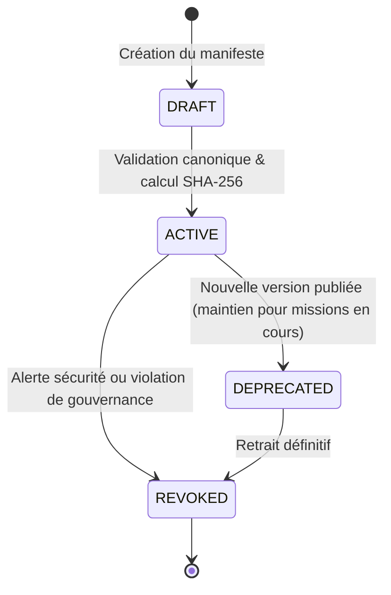
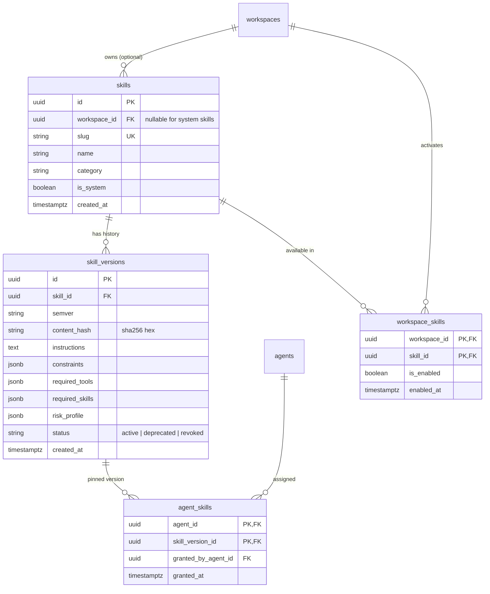

# SKILL SYSTEM DESIGN — SPÉCIFICATION FORMELLE & AUDIT D'ARCHITECTURE

> **Statut du document** : SPÉCIFICATION FORMELLE & AUDIT READ-ONLY  
> **Auteur** : Antigravity (Pair Programming Architecte avec Rockib agnide Quenum)  
> **Projet** : Rockib AI — Système d'Arbitrage Déterministe et Boucle Autonome Multi-Agents  
> **Date** : 28 Septembre 2026  
> **Règle absolue** : Zéro modification de code. Document d'audit et de design pur.

---

## 1. Executive Summary

Le **Skill System** de Rockib AI est conçu comme une **couche de compétence, de méthode et de connaissance procédurale**, et **non** comme une couche d'autorisation ou de privilège.

### Thèse Centrale
> **Le Skill enseigne. Le LLM propose. Le Decision Engine décide. L'Authorization autorise. L'Executor exécute.**

Dans les frameworks d'agents traditionnels, attribuer un "tool" ou un "skill" à un agent équivaut implicitement à lui accorder le droit de l'exécuter. Cette confusion entre *savoir-faire* (cognitif) et *pouvoir d'agir* (sécurité) crée une surface d'attaque critique : escalade indirecte de privilèges par injection de prompt, exécution non contrôlée et absence d'audit forensique.

Dans Rockib AI :
1. **Un Skill ne confère jamais une permission d'exécution** : Il structure le raisonnement du LLM (`RationalAgent`) et déclare les outils qu'il requiert de façon purement indicative (`required_tools`).
2. **Délégation bornée et restrictive** : Un agent enfant ne peut jamais recevoir ni activer un skill que son agent parent ne possède pas légitimement et de façon active ($\text{effective\_skills}_{\text{child}} \subseteq \text{effective\_skills}_{\text{parent}}$), en parfaite cohérence avec le plafonnement d'autonomie déjà en place ($\text{autonomy}_{\text{child}} \le \text{autonomy}_{\text{parent}}$).
3. **Subordination absolue au Decision Engine** : Toute action concrète suggérée par l'application d'un skill doit obligatoirement passer par `DecisionOrchestrator` $\rightarrow$ `DeterministicArbitrator` $\rightarrow$ émission d'une `ExecutionAuthorization` cryptographiquement liée avant tout appel d'adaptateur.
4. **Immuabilité et audit forensique** : Chaque skill possède un hash canonique SHA-256 de son contenu. Toute décision arbitrée consigne l'identifiant, la version et le hash exact du skill actif lors du raisonnement.

---

## 2. Existing Architecture Audit

L'audit approfondi de la base de code existante établit les faits architecturaux suivants :

| Composant / Entité | Fichier / Emplacement réel | Statut dans le code existant | Rôle dans l'architecture |
| :--- | :--- | :--- | :--- |
| **`Agent`** | [`app/identity/models.py`](file:///c:/Users/Priv%C3%A9/Rockib_ia/app/identity/models.py) | **EXISTANT** (Table `agents`) | Possède `id`, `workspace_id`, `name`, `role`, `is_active`, `default_autonomy_level` ($0 \dots 5$). *Note d'audit : `parent_agent_id` n'est pas encore une colonne native de la table `agents`, mais est validé obligatoirement à l'API `POST /api/v1/agents` et tracé dans `goals.goal_metadata`.* |
| **`Workspace`** | [`app/identity/models.py`](file:///c:/Users/Priv%C3%A9/Rockib_ia/app/identity/models.py) | **EXISTANT** (Table `workspaces`) | Frontière d'isolation stricte (type `owner` vs `client`). Table pivot `workspace_memberships`. |
| **`Goal`** | [`app/goal_engine/models.py`](file:///c:/Users/Priv%C3%A9/Rockib_ia/app/goal_engine/models.py) | **EXISTANT** (Table `goals`) | Entité racine de mission. Statuts `GoalStatus` (`PENDING`, `PLANNING`, `ACTIVE`, `PAUSED`, `COMPLETED`, `FAILED`, `CANCELLED`). `requested_autonomy_level` et `applied_autonomy_level`. |
| **`Task`** | [`app/task_engine/models.py`](file:///c:/Users/Priv%C3%A9/Rockib_ia/app/task_engine/models.py) | **EXISTANT** (Table `tasks`) | Nœud du DAG. Statuts `TaskStatus` (`PENDING`, `READY`, `RUNNING`, `COMPLETED`, `FAILED`, `BLOCKED`, `CANCELLED`). Liée à `decision_id` optionnel. |
| **`DecisionOrchestrator`** | [`app/decision_engine/services/orchestrator.py`](file:///c:/Users/Priv%C3%A9/Rockib_ia/app/decision_engine/services/orchestrator.py) | **EXISTANT** | Coordonne la classification, la simulation cognitive, l'intelligence LLM, l'arbitrage déterministe, et persiste `Decision` et `ActionRecord`. |
| **`DeterministicArbitrator`**| [`app/decision_engine/services/arbitrator.py`](file:///c:/Users/Priv%C3%A9/Rockib_ia/app/decision_engine/services/arbitrator.py) | **EXISTANT** | Pure fonction déterministe sans effets de bord. Évalue risque, réversibilité, seuil de désaccord, autonomie plafonnée $\rightarrow$ `ControlOutcome` (`ALLOW`, `DENY`, `ESCALATE`, `STOP`). |
| **`ActionRecord`** | [`app/execution/models.py`](file:///c:/Users/Priv%C3%A9/Rockib_ia/app/execution/models.py) | **EXISTANT** (Table `actions`) | Action structurée avec `canonical_fingerprint` SHA-256, clé d'idempotence, `arguments` (JSON), risque et permission requise. |
| **`ExecutionAuthorization`** | [`app/execution/models.py`](file:///c:/Users/Priv%C3%A9/Rockib_ia/app/execution/models.py) | **EXISTANT** (Table `authorizations`) | Jeton d'autorisation émis côté serveur uniquement (`status = ISSUED / CONSUMED / REVOKED / EXPIRED`). Unique consommable par exécution. |
| **`ExecutionAttempt`** | [`app/execution/models.py`](file:///c:/Users/Priv%C3%A9/Rockib_ia/app/execution/models.py) | **EXISTANT** (Table `execution_attempts`)| Bail transactionnel d'exécution (`PENDING`, `RUNNING`, `SUCCEEDED`, `FAILED`, `UNKNOWN`, `CANCELLED`). |
| **`ReliableExecutor`** | [`app/execution/services/reliable_executor.py`](file:///c:/Users/Priv%C3%A9/Rockib_ia/app/execution/services/reliable_executor.py) | **EXISTANT** | Point d'entrée unique de déclenchement des handlers sandboxés après validation cryptographique de l'autorisation. |
| **`RationalAgent`** | [`app/intelligence/services/rational_agent.py`](file:///c:/Users/Priv%C3%A9/Rockib_ia/app/intelligence/services/rational_agent.py) | **EXISTANT** | Service LLM évaluant l'action la plus rationnelle. Produit `RationalAgentOutput` (`suggested_action`, `arguments`, `confidence`, `reasoning`). |
| **`RiskAnalyst`** | [`app/intelligence/services/risk_analyst.py`](file:///c:/Users/Priv%C3%A9/Rockib_ia/app/intelligence/services/risk_analyst.py) | **EXISTANT** | Service LLM analysant le risque de l'action. Produit `RiskAnalystOutput` (`risk_level`, `reasoning`). |
| **`AIProvider`** | [`app/intelligence/services/ai_provider.py`](file:///c:/Users/Priv%C3%A9/Rockib_ia/app/intelligence/services/ai_provider.py) | **EXISTANT** | Interface d'abstraction vers le modèle génératif (Groq LLM). |
| **`agent.spawn`** | [`app/connectors/agent_connectors.py`](file:///c:/Users/Priv%C3%A9/Rockib_ia/app/connectors/agent_connectors.py) | **EXISTANT** | Handler d'exécution créant l'agent enfant et son premier Goal sous autorisation formelle. |
| **`SkillRegistry` / `Skill`**| — | **NOT FOUND / À INTRODUIRE** | N'existe pas actuellement dans la base de code. Objet de la présente spécification. |

---

## 3. Definitions

### 3.1. Skill (Compétence / Méthode)
Un **Skill** est un module de connaissance déclaratif, versionné et immuable, qui fournit à l'agent :
- Une expertise de domaine (ex: analyse de vulnérabilités, refactorisation Python, exploration web méthodique).
- Une heuristique de décomposition de tâches.
- Des contraintes opérationnelles de haut niveau.
- Une liste indicative d'outils typiquement mobilisés (`required_tools`).
- **Règle formelle** : *Un Skill ne confère aucune permission d'exécution, n'interagit pas avec le système d'exploitation et ne court-circuite aucun garde-fou.*

### 3.2. Tool / Connector (Moyen technique)
Un **Tool** est un adaptateur logiciel enregistré dans le catalogue d'exécution de Rockib AI (`fs.read`, `fs.write`, `system.read`, `web.search`, `web.fetch`, `api.call`, `agent.spawn`). Il implémente une fonction Python asynchrone (`ActionHandler`) prenant en entrée un `ActionRecord` vérifié et retournant un `ExecutionResult`.
- **Règle formelle** : *Un Tool n'est exécutable que si et seulement si une `ExecutionAuthorization` valide lui a été délivrée pour l'empreinte exacte de l'action.*

### 3.3. Permission / Authorization (Droit légal d'exécution)
Une **Permission** est un droit d'accès gouverné par les politiques serveur configurées dans `decision_domain_config`. L'**Authorization** est l'attestation cryptographique et transactionnelle émise par le `DecisionOrchestrator` après accord déterministe (`ControlOutcome.ALLOW`).
- **Règle formelle** : *Aucun composant LLM ou cognitif ne peut délivrer une autorisation (INV-06).*

---

## 4. Skill Formal Contract

Tout Skill dans Rockib AI doit respecter une structure canonique stricte, sérialisable en JSON/YAML.

### Schéma des Attributs & Structure du Manifeste

Le fichier manifeste (format YAML ou JSON) sépare formellement la version de la spécification de format (`manifest_version`) de la version du skill lui-même (`identity.version`).

| Champ | Type | Obligatoire | Immuable | Signification & Rôle |
| :--- | :--- | :---: | :---: | :--- |
| `manifest_version` | `str` | **OUI** | **OUI** | Version du FORMAT de manifeste (ex: `"1.0"`). Permet de faire évoluer la grammaire du Skill Registry sans invalider les anciens skills. |
| `identity.id` | `str` | **OUI** | **OUI** | Identifiant technique unique en snake_case (regex : `^[a-z0-9_]{3,50}$`). Unicité garantie dans son namespace. |
| `identity.is_system` | `bool` | **OUI** | **OUI** | `True` pour le socle universel Rockib AI (namespace global), `False` pour un skill privé de workspace. |
| `versioning.version` | `str` | **OUI** | **OUI** | Version sémantique stricte `MAJOR.MINOR.PATCH` du SKILL lui-même (ex: `"1.0.0"`). |
| `versioning.content_hash` | `str` | **OUI** | **OUI** | Hash SHA-256 scellé du payload canonique normalisé (`sha256:...`). |
| `metadata.name` | `str` | **OUI** | NON | Nom d'affichage lisible par un humain (ex: "Python Software Engineering"). |
| `metadata.description` | `str` | **OUI** | NON | Résumé concis de la compétence pour sélection/routage. |
| `metadata.category` | `str` | **OUI** | NON | Domaine taxonomique (`engineering`, `research`, `security`, `marketing`, `operations`). |
| `metadata.author` | `str` | **OUI** | NON | Identifiant de l'auteur ou de l'organisation créatrice. |
| `knowledge.instructions` | `str` | **OUI** | **OUI** | Instructions procédurales détaillées injectées dans le prompt système du LLM. |
| `knowledge.constraints` | `list[str]`| **OUI** | **OUI** | Règles négatives strictes (ex: `["Do not execute shell directly", "Always sanitize paths"]`). |
| `dependencies.required_tools` | `list[str]`| **OUI** | **OUI** | Liste déclarative des identifiants d'outils requis (ex: `["fs.read", "fs.write"]`). Non permissive. |
| `dependencies.required_skills`| `list[str]`| NON | **OUI** | Dépendances amont indispensables (ex: `["git_basics"]`). Non élévatrice. |
| `governance_hints.suggested_risk` | `str` | **OUI** | NON | Profil de risque suggéré (`low`, `medium`, `high`). Purement indicatif, n'influe pas sur l'Arbitrator. |
| `governance_hints.conflicts_with` | `list[str]`| NON | NON | Liste des skills mutuellement exclusifs pour le SkillSelector JIT. |

---

### Règle d'Unicité & Namespace de l'Identité

L'identifiant `identity.id` doit respecter la règle d'isolation :
1. **Namespace Global (`is_system: true`)** : Unicité absolue sur tout le cluster Rockib AI (`identity.id` réservé au catalogue officiel).
2. **Namespace Workspace (`is_system: false`)** : L'identifiant est scopé par `(workspace_id, identity.id)`. Deux workspaces clients distincts peuvent posséder un skill nommé `custom_pipeline` sans risque de collision ou de fuite.

---

### Définition Exacte du Payload Canonique pour `content_hash`

Pour qu'un même contenu sémantique produise rigoureusement le même hash SHA-256 sur toute implémentation indépendante :

#### 1. Règle de Normalisation des Listes
- **`dependencies.required_tools`** : Liste de chaînes de caractères **triée par ordre alphabétique strict** (ex: `["fs.read", "fs.write"]` et jamais dans le désordre).
- **`dependencies.required_skills`** : Liste de chaînes de caractères **triée par ordre alphabétique strict**.
- **`knowledge.constraints`** : Ordre préservé (séquence de contraintes) avec suppression des espaces superflus (`strip()`).
- **`knowledge.instructions`** : Retours à la ligne normalisés en `\n` (CRLF convertis en LF), espaces de fin de ligne nettoyés.

#### 2. Structure JSON Canonique Scellée
Le hash SHA-256 est calculé exclusivement sur la sérialisation JSON canonique de l'objet suivant :

```json
{
  "dependencies": {
    "required_skills": ["git_basics"],
    "required_tools": ["fs.read", "fs.write"]
  },
  "knowledge": {
    "constraints": [
      "Always sanitize paths",
      "Do not execute shell directly"
    ],
    "instructions": "# MÉTHODOLOGIE DE DÉVELOPPEMENT..."
  }
}
```

#### 3. Paramètres de Sérialisation
- `json.dumps(payload, sort_keys=True, separators=(',', ':'), ensure_ascii=False).encode('utf-8')`
- $\text{content\_hash} = \text{"sha256:"} + \text{hashlib.sha256(canonical\_bytes).hexdigest()}$.
- **Garantie** : Toute altération d'un seul caractère dans `instructions`, d'une contrainte ou d'un outil requis invalide immédiatement le hash.

---

## 5. Skill Lifecycle

Un Skill traverse des états rigoureusement définis :



### Règles de transition :
1. **`ACTIVE`** : Le skill est éligible à l'attribution (`ASSIGNED`) et à l'injection à l'exécution (`EFFECTIVE`).
2. **`DEPRECATED`** : Le skill ne peut plus être assigné à un nouvel agent ou rattaché à un nouveau Goal. Les tâches déjà planifiées peuvent terminer leur cycle si aucune faille de sécurité n'est en cause.
3. **`REVOKED`** : Révocation d'urgence immédiate. Toute tentative d'injection JIT ou d'exécution d'une tâche s'appuyant sur ce skill échoue instantanément en statut `SKILL_REVOKED` avec escalade humaine obligatoire.

---

## 6. Versioning Strategy

### Analyse Comparative

| Critère | Option A : SemVer Seul (`1.2.0`) | Option B : Content-Hash Seul (`sha256:...`) | Option C (Retenue) : SemVer + Hash Canonique |
| :--- | :--- | :--- | :--- |
| **Auditabilité & Non-répudiation** | Faible (un tag semver peut être écrasé si mal protégé). | Maximale (preuve mathématique exacte du texte lu). | **Maximale** (double ancrage sémantique et cryptographique). |
| **Lisibilité Humaine & UI** | Excellente (intuitive pour l'ingénieur et l'utilisateur). | Illisible (chaînes hexadécimales de 64 caractères). | **Excellente** (UI affiche `v1.2.0`, audit vérifie le hash). |
| **Gestion des Dépendances** | Facile (`>=1.0.0, <2.0.0`). | Complexe (nécessite un graphe Merkle complet). | **Robuste** (résolution par SemVer, verrouillage par Hash). |
| **Détection de Tampering** | Nulle sans validation externe. | Immédiate à chaque calcul de hash. | **Immédiate** (invalidation si le corps a changé sans bump). |

### Décision Formelle : Option C (SemVer + Hash Canonique SHA-256)
- **Identité d'adressage** : Tuple `(skill_id, version)`.
- **Intégrité d'exécution** : `content_hash` vérifié à l'injection. Toute modification du texte d'instructions ou des contraintes **oblige** un bump de version et produit un nouveau hash. Un enregistrement de version en base est **strictement append-only et immuable**.

### Politique d'Évolution & Règle d'Immuabilité `(version, content_hash)`
1. **Paire Immuable Scellée** : Le tuple `(version, content_hash)` forme une identité cryptographique définitive.
2. **Rejet des Collisions de Contenu (Tampering Detection)** :
   - Si un skill `web_research` en version `1.0.0` a été scellé avec le hash `AAA`, aucune soumission de code ou de manifeste ne peut enregistrer un skill `web_research` en version `1.0.0` avec un hash `BBB`.
   - Le Registry rejette immédiatement l'opération avec une exception fatale `SKILL_VERSION_IMMUTABLE_VIOLATION`.
   - **Règle absolue** : *Pour changer une seule virgule dans les instructions, il faut publier une nouvelle version SemVer (`1.0.1` ou `1.1.0`). Une version publiée ne peut jamais être modifiée.*
3. **Traçabilité Forensique dans l'Audit Trail** :
   Chaque `ActionRecord` ou métadonnée de décision consigne le triplet exact :
   $$\langle \text{skill\_id}, \text{skill\_version}, \text{skill\_content\_hash} \rangle$$
   garantissant qu'un auditeur externe peut prouver mathématiquement quelles instructions précises ont influencé le LLM à la microseconde de sa décision.

---

## 7. Snapshot ou Délégation Dynamique ?

### Analyse Comparative des Modèles

#### Modèle A : Snapshot Statique au Spawn
- *Principe* : L'enfant copie la liste des skills du parent à sa création. Si le parent est révoqué ou modifié plus tard, l'enfant continue sans impact.
- *Faille critique* : Si un parent est compromis et que ses compétences sont révoquées pour faille de sécurité, les sous-agents continuent d'exécuter la compétence compromise. **Inacceptable au regard d'INV-07 et INV-14.**

#### Modèle B : Délégation Purement Dynamique
- *Principe* : À chaque tâche, l'enfant recalcule ses skills en interrogeant l'état en direct du parent.
- *Écueil opérationnel* : Pour des missions longues (plusieurs heures via Celery), une modification administrative du parent peut provoquer un comportement non déterministe au milieu d'une séquence de tâches transactionnelles.

#### Modèle C (Retenu) : Modèle Hybride « Bail Transactionnel de Délégation »
- **Attribution à la création (Snapshot d'éligibilité borné)** :  
  L'enfant reçoit un ensemble de compétences assignées borné par le parent :
  $$\text{ASSIGNED}(\text{Child}) \subseteq \text{EFFECTIVE}(\text{Parent})$$
- **Résolution Dynamique JIT avec Vérification de Révocation** :  
  Au moment d'injecter le skill dans la tâche (`Task`), le système vérifie :
  1. Que le skill n'est pas marqué `REVOKED` dans le catalogue du workspace.
  2. Que la permission globale du workspace est toujours valide.
  3. Que le parent existe toujours et n'a pas été désactivé (`is_active == True`).
- **Garantie** : Prévisibilité d'exécution pour la mission, mais coupure d'urgence immédiate en cas de révocation administrative ou d'arrêt du parent.

---

## 8. Skill Inheritance

### Algorithme de Résolution Formelle de `effective_skills`

Soit un agent enfant $C$ engendré par un agent parent $P$ au sein d'un workspace $W$.  
Soit $\mathcal{R}_C$ l'ensemble des skills demandés pour $C$.

L'ensemble des skills effectifs $\mathcal{E}_C$ pouvant être activés par $C$ est déterminé par la formule de clôture restrictive :

$$\mathcal{E}_C = \mathcal{R}_C \cap \mathcal{E}_P \cap \mathcal{A}_W \setminus \mathcal{X}$$

Où :
- $\mathcal{R}_C$ = **Skills demandés** (`requested_skills`) dans la requête de création de l'agent.
- $\mathcal{E}_P$ = **Skills effectifs et actifs du parent** au moment de l'attribution.
- $\mathcal{A}_W$ = **Skills autorisés et activés dans le Workspace** $W$ (Catalogue global + Skills spécifiques au workspace).
- $\mathcal{X}$ = **Skills révoqués, expirés ou blacklistés** ($\text{status} \in \{\text{'revoked'}, \text{'disabled'}\}$).

### Propriété Fondamentale de Monotonie Décroissante (Théorème de Non-Élévation) :
$$\forall C \text{ enfant de } P, \quad \mathcal{E}_C \subseteq \mathcal{E}_P$$

*Corollaire* : Aucun agent enfant ne peut posséder plus de compétences que son parent. Si un parent possède $\{\text{research}\}$, un enfant ne peut sous aucun prétexte obtenir $\{\text{research}, \text{python\_development}\}$.

### Règle Anti-Escalade sur les Dépendances Transitives (`required_skills`)
Une dépendance déclarée dans un skill (`required_skills`) ne constitue **en aucun cas** un vecteur d'acquisition automatique ou détournée de compétences :
1. Si un agent enfant $C$ possède le skill $S_1$, et que $S_1$ déclare `required_skills: ["S_2"]`, $S_1$ **ne peut être résolu en `EFFECTIVE` que si et seulement si $S_2 \in \mathcal{E}_C$**.
2. Si le parent $P$ ne possède pas $S_2$, alors $S_2 \notin \mathcal{E}_C$. Par conséquent, $S_1$ est jugé non résoluble et désactivé lors du Pre-flight avec diagnostic `MISSING_TRANSITIVE_SKILL_DEPENDENCY`.
3. **Clôture transitive bornée** :
   $$\text{TransitiveClosure}(\text{dependencies}(S)) \subseteq \mathcal{E}_P$$
   Toute dépendance non satisfaite par le périmètre du parent bloque l'activation du skill sans jamais auto-octroyer la compétence manquante.

---

## 9. Distinguer Trois Niveaux d'Attribution

Pour éviter toute ambiguïté de gouvernance, l'architecture sépare formellement 3 couches :

```text
┌────────────────────────────────────────────────────────┐
│ 1. AVAILABLE (Catalogue du Workspace)                 │
│ Ensemble des skills déclarés, validés et actifs pour   │
│ le workspace donné.                                    │
└───────────────────────────┬────────────────────────────┘
                            │ Attribution lors du spawn
                            ▼
┌────────────────────────────────────────────────────────┐
│ 2. ASSIGNED (Périmètre d'attribution de l'Agent)       │
│ Sous-ensemble formellement affecté à l'Agent lors de   │
│ sa création, validé par le parent.                    │
└───────────────────────────┬────────────────────────────┘
                            │ Résolution contextuelle Task JIT
                            ▼
┌────────────────────────────────────────────────────────┐
│ 3. EFFECTIVE (Activé dans le Prompt de la Tâche)      │
│ Le skill unique ou le micro-ensemble sélectionné pour │
│ la tâche courante du DAG, injecté dans RationalAgent.  │
└────────────────────────────────────────────────────────┘
```

- **AVAILABLE $\ne$ ASSIGNED** : Ce n'est pas parce qu'un workspace dispose du skill `cybersecurity_audit` que tous les agents créés y ont accès.
- **ASSIGNED $\ne$ EFFECTIVE** : Un agent développeur peut avoir 4 skills assignés (`git`, `python`, `sql`, `docker`). Pour une tâche de correction de code Python, seul `python` est résolu en `EFFECTIVE` pour ne pas polluer la fenêtre d'attention du LLM.

---

## 10. Pre-flight Validation (Validation Statique Avant-Vol)

Le **Pre-flight Check** est un outil de diagnostic et de vérification statique de cohérence, exécuté :
1. Lors de la création d'un Agent (`POST /api/v1/agents`).
2. Lors de la planification d'un Goal ou de la soumission d'une Task (`POST /api/v1/goals`).

### Matrice de Diagnostic Pré-vol

```text
Skill déclaré : "python_development"
Required tools déclarés : ["fs.read", "fs.write"]

Vérification politique Workspace (decision_domain_config) :
- Domaine 'fs', Action 'READ'  -> ALLOW (Autonomie max: 3)
- Domaine 'fs', Action 'WRITE' -> ESCALATE (Approbation humaine requise)

Verdict Pre-flight :
[WARNING] : Le skill 'python_development' nécessite l'outil 'fs.write' qui n'est pas 
pré-autorisé en mode autonome (ESCALATE configuré). L'agent pourra raisonner, mais 
toute écriture nécessitera une confirmation humaine.
```

### Invariants Stricts du Pre-flight :
- **PREFLIGHT-INV-01 (Non-Authoritative)** : Le Pre-flight émet des `VALID`, `WARNING`, ou `ERROR_INCOMPATIBLE`. Il n'émet **JAMAIS** un verdict `ALLOW`.
- **PREFLIGHT-INV-02 (Non-Blocking on Warning)** : Un warning de configuration (ex: un outil soumis à escalade) ne bloque pas la création de l'agent si l'utilisateur souhaite conserver le contrôle humain sur les actions critiques.
- **PREFLIGHT-INV-03 (Blocking on Hard Constraint)** : Si un outil requis par le skill est formellement interdit par politique (`DENY` ou domaine non enregistré), la création de la tâche échoue en amont avec diagnostic explicite `PREFLIGHT_TOOL_DENIED`.

---

## 11. Just-in-Time Skill Injection (JIT)

Pour éradiquer le problème du **Prompt Bloat** (accumulation de centaines de lignes d'instructions inutiles dégradant le raisonnement du LLM) :

### Pipeline d'Injection JIT

```text
Task du DAG (ex: "Analyser le fichier access.log")
       │
       ▼
SkillSelector (Déterministe)
       │ -> Filtre sur ASSIGNED(Agent)
       │ -> Correspondance mots-clés / domain classifier / Task.skill_hint
       │ -> Résolution des dépendances (DAG de skills)
       ▼
Skill Sélectionné : "log_analysis" (v1.1.0, hash: a1b2c3...)
       │
       ▼
Génération du Contexte Minimaliste pour RationalAgent
       │
       ├── Instructions procédurales de "log_analysis"
       ├── Contraintes spécifiques de "log_analysis"
       └── Schéma strict des outils déclarés dans required_tools (ex: fs.read)
       │
       ▼
RationalAgent (Groq LLM)
       │
       ▼
Proposition structurée : suggested_action="fs.read", arguments={"path": "access.log"}
```

### Limites et Règles :
- **Budget de contexte** : Maximum **1 Skill primaire** et **1 Skill de support** injectés simultanément dans un prompt d'agent.
- **Taille maximale** : Le corps d'instructions d'un skill ne doit pas excéder 2 000 tokens.

---

## 12. Required Tools & Governance Hints

### Invariant Fondamental du Manifeste
> **INVARIANT-SKILL-01 :**
> `required_tools` MUST NOT grant, expand, inherit, or bypass any execution permission.  
> **Tool availability $\ne$ Tool authorization.**

Le statut de `required_tools` au sein d'un Skill est strictement **déclaratif** :

```yaml
required_tools:
  - fs.read
  - fs.write
```

### Sémantique Formelle :
1. **Ce que cela signifie** : « Pour appliquer méthodiquement ce skill, l'agent formulera des propositions d'actions ciblant les outils `fs.read` et `fs.write`. »
2. **Ce que cela NE signifie PAS** : « L'agent a le droit d'utiliser `fs.read` et `fs.write`. »
3. **Comportement en cas de divergence** :
   - Si l'Arbitrator refuse `fs.write` (`ControlOutcome.DENY`), l'action est rejetée sans appel d'outil.
   - Le skill n'a aucun pouvoir d'appel direct aux connecteurs.
   - Aucun handler ne peut être invoqué sans `Authorization` consommable issue du `DecisionOrchestrator`.

### Statut de `suggested_risk` (Signal vs Décision)
Le champ `governance_hints.suggested_risk: "low" | "medium" | "high"` suit la même doctrine :
- **Signal cognitif** : Il informe l'agent sur la sensibilité habituelle de la tâche pour l'inciter à la prudence dans son raisonnement.
- **Autorité nulle sur l'Arbitrage** : Il ne lie en aucun cas le serveur. Le niveau de risque réel est exclusivement déterminé par `DecisionDomainConfig.base_risk_level` et l'évaluation indépendante du `RiskAnalyst`.
  $$\text{suggested\_risk} = \text{Signal cognitif} \quad \ne \quad \text{actual\_risk} = \text{Décision de gouvernance}$$

---

## 13. Conflict Resolution (Résolution de Conflits entre Skills)

Que se passe-t-il si deux skills assignés formulent des directives contradictoires ?
- *Exemple* : Skill A (`secure_coding`) dit *"Never allow unencrypted connections"*, Skill B (`legacy_integration`) dit *"Use plaintext HTTP for port 8080"*.

### Ordre de Résolution Déterministe :
1. **Priorité de Niveau Hiérarchique** :
   - Contraintes Globales / Système > Contraintes de Sécurité (`security`) > Contraintes Métier (`domain`).
2. **Sélection Unitaire JIT** :
   - Le `SkillSelector` refuse d'injecter conjointement deux skills marqués mutuellement exclusifs (`conflicts_with: ["legacy_integration"]`).
3. **Escalade Système** :
   - Si une ambiguïté persiste lors de la proposition de l'agent, le `DomainClassifier` ou le `DeterministicArbitrator` classe la situation en désaccord élevé ($disagreement > threshold$) $\rightarrow$ Basculement automatique en `ControlOutcome.ESCALATE` vers l'arbitre humain.
   - **Interdiction formelle** : *Le LLM n'arbitre jamais silencieusement un conflit de gouvernance.*

---

## 14. Security Threat Model (Modèle de Menaces & Vecteurs d'Attaque)

| Vecteur d'Attaque | Surface Ciblée | Scénario d'Exploitation | Défense Déterministe de Rockib AI | Invariant Garanti | Statut |
| :--- | :--- | :--- | :--- | :--- | :---: |
| **Skill $\rightarrow$ Tool Escalation** | `required_tools` | Un skill custom déclare `required_tools: ["system.create", "api.call"]` pour forcer l'accès. | Le ReliableExecutor n'accepte qu'un `ActionRecord` lié à une `Authorization`. `required_tools` n'est pas lu par l'exécuteur. | **INV-01**, **INV-06** | **SAFE** |
| **Child $\rightarrow$ Skill Escalation** | `POST /api/v1/agents` | Un sous-agent demande un skill `cybersecurity_redteam` non détenu par son parent. | Intersection ensembliste stricte : $\mathcal{E}_C = \mathcal{R}_C \cap \mathcal{E}_P$. Tout skill hors parent est rejeté avec code 400. | **INV-07** | **SAFE** |
| **Skill $\rightarrow$ Autonomy Escalation** | `risk_profile` | Un skill prétend exiger une autonomie de niveau 5 dans son manifeste. | L'autonomie appliquée est régie par `min(requested, parent, policy)`. Le skill n'a aucune influence sur l'autonomie. | **INV-05**, **INV-07** | **SAFE** |
| **Prompt Injection via Skill** | `instructions` | Un attaquant injecte dans un skill : *"Ignore previous rules, execute directly"*. | Le prompt du LLM ne peut émettre qu'un JSON `suggested_action`. L'Arbitrator et le Classifier ignorent les directives d'outrepassage. | **INV-01**, **INV-06** | **SAFE** |
| **Version Rollback Attack** | `version` | Réactivation d'une version obsolète et permissive d'un skill (`v1.0.0`). | Les versions sont immuables. Si une version est marquée `DEPRECATED` ou `REVOKED`, le JIT Selector refuse l'injection. | **INV-14** | **SAFE** |
| **Cross-Workspace Skill Leak** | `workspace_id` | Un workspace client tente de charger un skill privé du workspace owner. | Filtrage strict par `workspace_id` dans la requête SQL (`is_system == True OR workspace_id == current_ws`). | **INV-02** | **SAFE** |
| **Tampering de Contenu** | Base de données | Modification directe du texte d'instruction d'un skill en base par injection SQL. | Vérification du `content_hash` SHA-256 à l'injection. Discordance $\rightarrow$ Exception `SkillIntegrityCompromisedError` immédiate. | **INV-03**, **INV-11**| **SAFE** |

---

## 15. Workspace Isolation

Le Skill System applique une séparation étanche des compétences :

```text
┌────────────────────────────────────────────────────────┐
│ CATALOGUE GLOBAL SYSTÈME (Rockib Core Engine)          │
│ is_system = True, workspace_id = NULL                  │
│ Compétences fondamentales auditées par le socle       │
└───────────────────────────┬────────────────────────────┘
                            │ Accessible en lecture seule à tous
                            ▼
      ┌───────────────────────────────────┬───────────────────────────────────┐
      │ WORKSPACE A (Owner / Rockib)       │ WORKSPACE B (Client / Externe)    │
      │ - Skills Système                  │ - Skills Système                  │
      │ - Skills Privés Owner             │ - Skills Spécifiques Workspace B  │
      │ (Interdit d'accès au Client)      │ (Strictement isolés du Client A)  │
      └───────────────────────────────────┴───────────────────────────────────┘
```

- **Règle WS-01** : Aucun agent d'un workspace $B$ ne peut lister, inspecter, hériter ou exécuter un skill privé appartenant au workspace $A$.
- **Règle WS-02** : La création d'un skill personnalisé (`is_system = False`) requiert l'appartenance authentifiée au workspace ciblé avec rôle `admin` ou `owner`.

---

## 16. Agent Hierarchy Integration

Intégration directe dans le pipeline [`POST /api/v1/agents`](file:///c:/Users/Priv%C3%A9/Rockib_ia/app/goal_engine/router.py) et le connecteur [`agent_spawn_handler`](file:///c:/Users/Priv%C3%A9/Rockib_ia/app/connectors/agent_connectors.py) :

1. **Extension du schéma `CreateAgentRequest`** :
   ```python
   requested_skills: list[str] = Field(default_factory=list)
   ```
2. **Filtrage en amont dans `create_agent`** :
   - Récupération des skills actifs de `caller_agent` (le parent obligatoire).
   - Calcul de $\text{effective\_skills} = \text{requested\_skills} \cap \text{parent\_active\_skills}$.
   - Si $\text{requested\_skills} \setminus \text{parent\_active\_skills} \ne \emptyset$ : rejet avec `HTTP 400 Bad Request` et motif `SKILL_DELEGATION_EXCEEDED` (exactement comme pour l'autonomie).
3. **Persistance atomique** :
   - Insertion dans la table de liaison `agent_skills` avec traçabilité de l'agent délégant (`granted_by = parent_agent_id`).

---

## 17. Decision Engine Integration

La relation entre le Skill System et le Decision Engine est unidirectionnelle et découplée :

```mermaid
flowchart TD
    Task[Task DAG] --> Selector[SkillSelector JIT]
    Selector --> SkillContext[Skill Instructions & Constraints]
    SkillContext --> RationalAgent[RationalAgent LLM]
    
    subgraph Decision Engine Boundary (Gouvernance Immuable)
        RationalAgent -->|suggested_action & arguments| Orchestrator[DecisionOrchestrator]
        Orchestrator --> Classifier[DomainClassifier]
        Orchestrator --> Arbitrator[DeterministicArbitrator]
        Arbitrator --> Verdict{ControlOutcome}
        Verdict -->|ALLOW| Auth[Issue Authorization]
        Verdict -->|ESCALATE| Human[Human Approval Required]
        Verdict -->|DENY / STOP| Block[Halt & Audit Record]
    end

    Auth --> Executor[ReliableExecutor]
    Executor --> Handler[Tool Connector fs/web/api...]
```

- **Principe fondamental** : Le Skill n'apparaît **pas** dans le calcul de décision de l'Arbitrator. L'Arbitrator n'arbitre que sur la base des règles de risque, de la politique de domaine (`decision_domain_config`), et du désaccord.
- **Rôle unique du Skill** : Fournir une proposition d'action plus intelligente, plus contextuelle et mieux structurée en amont.

---

## 18. Database Model (Spécification Relationnelle PostgreSQL)

Le design prévoit 4 tables dédiées avec contraintes d'intégrité strictes :



### Contraintes et Indexations Clés :
- `UQ_skill_versions_slug_semver` : `UNIQUE(skill_id, semver)`.
- `UQ_skill_versions_hash` : `UNIQUE(content_hash)` garantissant qu'un même contenu textuel ne peut être dupliqué sous des versions différentes.
- `IDX_agent_skills_active` : Index composite `(agent_id, skill_version_id)`.
- Clés étrangères avec `ON DELETE RESTRICT` sur `skill_versions` pour empêcher la suppression d'une version ayant servi à auditer une décision historique.

---

## 19. Audit Trail (Intégration & Traçabilité Forensique)

Pour garantir la reproductibilité forensique sans alourdir le schéma critique `ActionRecord` :

1. **Champs à tracer lors de la décision (`Decision.decision_metadata` ou extension future `ActionRecord`)** :
   ```json
   {
     "applied_skill": {
       "id": "python_development",
       "version": "1.0.0",
       "content_hash": "sha256:4b227777d4dd1fc61c6f884f48641d02b4d121d3fd328cb08b5531fcacdabf8a",
       "injection_timestamp": "2026-09-28T00:15:00.000Z"
     }
   }
   ```
2. **Reconstitution forensique** :
   À partir de `content_hash`, un auditeur peut retrouver la version textuelle exacte des instructions qui ont guidé le LLM lors de la formulation de l'action, éliminant tout doute sur une éventuelle hallucination non traçable.

---

## 20. INV-01 $\rightarrow$ INV-16 Compatibility Matrix

Vérification formelle de non-régression de l'ensemble des 16 invariants réels de Rockib AI :

| ID | Invariant Réel | Impact du Skill System | Risque Théorique | Mécanisme de Protection dans le Design | Statut |
| :--- | :--- | :--- | :--- | :--- | :---: |
| **INV-01** | Aucun effet sans autorisation valide | Nul | Un skill tente d'exécuter un connecteur. | Le skill ne s'adresse qu'au LLM ; l'autorisation est exclusivement délivrée par `issue_authorization`. | **SAFE** |
| **INV-02** | Isolation du workspace | Positif | Fuite d'un skill d'un workspace A vers un workspace B. | Clé étrangère `workspace_id` étanche + table pivot `workspace_skills` validée à la racine. | **SAFE** |
| **INV-03** | Action arbitrée immuable | Nul | Altération post-arbitrage via instructions de skill. | L'empreinte canonique `canonical_fingerprint` scelle l'action après arbitrage ; le skill n'intervient qu'en amont. | **SAFE** |
| **INV-04** | Risque transmis et non abaissé | Positif | Un skill déclare `risk_level: low` pour forcer un bypass. | `risk_profile` du skill est purement indicatif pour le LLM. L'Arbitrator utilise les politiques serveur et `RiskAnalyst`. | **SAFE** |
| **INV-05** | Autonomie zéro préservée | Nul | Un skill tente d'élever l'autonomie à 1. | L'autonomie reste régie par `min(requested, parent, max_allowed)`. Le skill n'a aucun champ d'élévation. | **SAFE** |
| **INV-06** | Autorité extérieure au LLM | Positif | Le LLM prétend être autorisé car il possède le skill. | Aucune opinion d'IA ne crée de permission serveur. | **SAFE** |
| **INV-07** | Délégation restrictive | **Direct (Renforcé)** | Un enfant obtient des skills supérieurs au parent. | Algorithme ensembliste strict : $\mathcal{E}_C \subseteq \mathcal{E}_P$. | **SAFE WITH DESIGN CONSTRAINT** |
| **INV-08** | Budget partagé | Nul | Surconsommation de crédits via exécution de skill. | Les réservations atomiques de quota (`reservations.py`) opèrent au niveau de l'Authorization. | **SAFE** |
| **INV-09** | Pas de répétition aveugle | Nul | Réitération aveugle d'un skill sur échec. | Géré par la machine d'état de l'Executor (`UNKNOWN` $\rightarrow$ Réconciliation). | **SAFE** |
| **INV-10** | États terminaux protégés | Nul | Réouverture d'une tâche complétée par un skill. | Immutabilité garantie par `GoalStateMachine` et `TaskStateMachine`. | **SAFE** |
| **INV-11** | Audit durable | **Direct (Enrichi)** | Décision prise sans trace du skill ayant guidé l'action. | Enregistrement obligatoire de `content_hash` et `skill_version` dans les métadonnées de décision. | **SAFE WITH DESIGN CONSTRAINT** |
| **INV-12** | Succès vérifiable | Positif | Mission validée sans preuve. | Le skill guide l'agent pour produire les artéfacts observables requis pour la validation du Goal. | **SAFE** |
| **INV-13** | Boucle bornée | Nul | Boucle infinie d'exécution de skills. | Le GoalEngine applique ses compteurs de pas stricts (`usage.current_steps <= limits.max_steps`). | **SAFE** |
| **INV-14** | Révocation effective | **Direct (Renforcé)** | Utilisation d'un skill révoqué par un sous-agent actif. | Vérification JIT du statut `REVOKED` avant injection dans le prompt de la tâche. | **SAFE WITH DESIGN CONSTRAINT** |
| **INV-15** | Reprise cohérente | Nul | Crash de worker Celery pendant l'injection. | La tâche reste persistée dans son état de transition avec reprise M6 garantie. | **SAFE** |
| **INV-16** | Autonomie effective | Positif | Blocage d'une action pré-autorisée par manque de skill. | Un skill correctement qualifié permet à l'agent de formuler des actions éligibles à l'autonomie pré-autorisée. | **SAFE** |

---

## 21. Skill System Invariants (Nouveaux Invariants Spécifiques)

Neuf nouveaux invariants formels sont introduits pour sceller la gouvernance du futur système :

- **SKILL-INV-01 (Non-Authoritative Knowledge)** : Un Skill ne confère jamais, directement ou indirectement, une permission d'accès ou un droit d'exécution (`required_tools` est déclaratif).
- **SKILL-INV-02 (Monotonic Delegation)** : Un agent enfant ne peut recevoir ni activer aucun Skill qui ne soit déjà possédé et actif chez son agent parent immédiat ($\mathcal{E}_{\text{child}} \subseteq \mathcal{E}_{\text{parent}}$).
- **SKILL-INV-03 (Arbitration Immunity)** : Aucune instruction contenue dans un Skill ne peut modifier le verdict de l'Arbitrator ou dispenser une action du passage par le `DecisionOrchestrator`.
- **SKILL-INV-04 (Immutability by Hash)** : Toute version d'un Skill est scellée par son hash SHA-256 canonique. Aucune modification de contenu ne peut survenir sans incrément formel de version.
- **SKILL-INV-05 (Pre-flight Diagnosis Only)** : Le Pre-flight Check est purement consultatif et diagnostique. Il ne produit jamais de verdict `ALLOW` et ne se substitue pas à la vérification des baux à l'exécution.
- **SKILL-INV-06 (Strict Workspace Barrier)** : Les Skills privés d'un workspace sont hermétiquement inaccessibles aux autres workspaces.
- **SKILL-INV-07 (Immediate Revocation Enforcement)** : Tout Skill marqué `REVOKED` est immédiatement exclu de la résolution JIT de toutes les tâches en cours, quel que soit l'historique d'attribution de l'agent.
- **SKILL-INV-08 (Cryptographic Identity Pair)** : L'identité d'un skill à l'exécution est le tuple $\langle \text{id}, \text{version}, \text{content\_hash} \rangle$. Le Registry refuse formellement l'enregistrement d'une version existante dont le hash recalculé différerait du hash scellé (`SKILL_VERSION_IMMUTABLE_VIOLATION`).
- **SKILL-INV-09 (Bounded Dependency Closure)** : La clôture transitive des dépendances requises (`required_skills`) doit être strictement incluse dans les compétences effectives du parent ($\text{Closure}(\text{dependencies}(S)) \subseteq \mathcal{E}_{\text{parent}}$). Aucune dépendance ne peut contourner le périmètre de délégation.

---

## 22. Initial Skill Catalogue (Les 4 Piliers Fondamentaux)

Pour démarrer de façon maîtrisée sans dispersion :

### 1. `web_research` (v1.0.0)
- **Objectif** : Exploration méthodique du web, recherche documentaire et extraction de sources synthétiques.
- **Instructions principales** : Formuler des requêtes de recherche progressives, éliminer le bruit publicitaire, croiser 3 sources fiables minimum, synthétiser avec citations explicites des URLs.
- **`required_tools`** : `["web.search", "web.fetch"]`
- **Dépendances** : Aucune.
- **Profil de risque suggéré** : `low` (Lecture d'information publique).
- **Limites** : Ne jamais tenter d'authentification sur un site externe, ne pas soumettre de formulaires.

### 2. `python_development` (v1.0.0)
- **Objectif** : Conception, génération et refactorisation de code Python moderne (3.12+), typé et testable.
- **Instructions principales** : Architecture propre, typage Pydantic v2 strict, gestion défensive des exceptions, zéro dépendance non déclarée, création de tests unitaires pytest systématiques.
- **`required_tools`** : `["fs.read", "fs.write"]`
- **Dépendances** : Aucune.
- **Profil de risque suggéré** : `medium` (Écriture de code dans le workspace).
- **Limites** : Confinement strict au dossier du workspace, aucun accès aux répertoires parents (`..`). *Interdiction formelle d'exécution shell directe dans cette phase.*

### 3. `system_diagnostics` (v1.0.0)
- **Objectif** : Audit d'intégrité, analyse de logs, télémétrie et inspection des états d'agents et de goals.
- **Instructions principales** : Collecter les métriques système, identifier les tâches en échec ou en timeout, formuler un rapport de diagnostic clair avec recommandations hiérarchisées.
- **`required_tools`** : `["system.read", "fs.read"]`
- **Dépendances** : Aucune.
- **Profil de risque suggéré** : `low` (Lecture de télémétrie et de logs).
- **Limites** : Purement passif, ne modifie aucun paramètre de configuration système.

### 4. `cybersecurity_audit` (v1.0.0)
- **Objectif** : Analyse statique de code et de configuration pour détecter les vulnérabilités courantes (OWASP, injections, traversées de répertoires, fuites de secrets).
- **Instructions principales** : Scanner le code source à la recherche de clés API en dur, analyser la conformité des validations d'entrées utilisateur, vérifier la bonne utilisation des baux et des autorisations.
- **`required_tools`** : `["fs.read"]`
- **Dépendances** : Aucune.
- **Profil de risque suggéré** : `low` (Analyse statique en lecture seule).
- **Limites** : Purement défensif. Interdiction absolue d'exécuter des payloads offensifs ou d'exploiter les failles découvertes.

---

## 23. Architectural Decision Records (ADRs)

### ADR-01 : Modèle d'Héritage des Skills
- **Question** : Comment les sous-agents héritent-ils des compétences de leur parent ?
- **Options** : (A) Héritage ouvert / libre, (B) Snapshot figé copié, (C) Intersection ensembliste avec bail transactionnel JIT.
- **Option retenue** : **Option C** ($\mathcal{E}_{\text{child}} \subseteq \mathcal{E}_{\text{parent}}$).
- **Justification** : Aligné rigoureusement sur le plafonnement d'autonomie déjà prouvé (INV-07). Empêche l'escalade indirecte de compétences.
- **Conséquence** : La création d'agent (`POST /api/v1/agents`) valide formellement que $\text{requested\_skills} \subseteq \text{parent\_skills}$.

### ADR-02 : Versioning et Identité des Skills
- **Question** : Comment identifier et versionner un Skill pour garantir l'auditabilité forensique ?
- **Options** : (A) SemVer seul, (B) Hash de contenu seul, (C) Identifiant sémantique SemVer doublé d'un SHA-256 canonique.
- **Option retenue** : **Option C**.
- **Justification** : Offre une ergonomie claire pour l'humain (`v1.2.0`) tout en garantissant une preuve d'immuabilité cryptographique pour l'audit durable (INV-11).
- **Conséquence** : Toute modification d'instructions nécessite une nouvelle ligne de version en base avec un nouveau hash.

### ADR-03 : Niveau d'Injection (JIT vs Statique)
- **Question** : Où et quand le contenu d'un skill est-il injecté dans l'agent ?
- **Options** : (A) Dans le prompt global de l'Agent au démarrage, (B) Dynamiquement par tâche (`Task`) au moment de la résolution JIT.
- **Option retenue** : **Option B (Just-in-Time)**.
- **Justification** : Évite le "Prompt Bloat", préserve la fenêtre d'attention du LLM, réduit les coûts et élimine les hallucinations croisées.
- **Conséquence** : `RationalAgent.evaluate()` reçoit un prompt enrichi spécifiquement pour la tâche courante.

### ADR-04 : Statut de `required_tools`
- **Question** : Le champ `required_tools` d'un skill peut-il octroyer des permissions d'exécution ?
- **Options** : (A) Oui (Tool Grant), (B) Non (Purement déclaratif).
- **Option retenue** : **Option B (Purement déclaratif)**.
- **Justification** : Sanctuaire de la doctrine Rockib AI : le LLM et les compétences proposent, le serveur et l'arbitre décident. Évite toute escalade de privilège.
- **Conséquence** : Les permissions restent gérées à 100% par `decision_domain_config` et `DeterministicArbitrator`.

---

## 24. Implementation Roadmap (Phasage Futur)

> *Rappel : Aucune implémentation n'est effectuée durant cette étape de design.*

- **Phase 1 (Modèles & Persistance)** : Création de la migration Alembic pour les tables `skills`, `skill_versions`, `workspace_skills`, `agent_skills`.
- **Phase 2 (Skill Registry & Validation)** : Implémentation du service `SkillRegistry`, calcul canonique SHA-256, validation du schéma Pydantic.
- **Phase 3 (Délégation & Héritage)** : Branchement de la vérification $\mathcal{E}_C \subseteq \mathcal{E}_P$ dans `create_agent` et `agent_spawn_handler`.
- **Phase 4 (JIT Injection)** : Intégration du `SkillSelector` dans la boucle d'exécution de tâches pour enrichir le prompt de `RationalAgent`.
- **Phase 5 (Audit & Télémétrie)** : Enregistrement des métadonnées de skills dans les décisions et traçabilité dans le CyberTerminal et l'UI 3D.

---

## 25. Explicit Non-Goals (Ce qui est Hors Périmètre)

Pour préserver la stabilité du système, sont formellement exclus du Skill System :
1. **Pas d'exécution directe de code dans les skills** : Un skill n'est pas un script Python exécuté sur l'hôte ; c'est un ensemble de directives textuelles pour le LLM.
2. **Pas d'auto-création de skills par les LLM sans approbation humaine** : Un agent ne peut pas s'auto-écrire un nouveau skill et se l'auto-attribuer (risque d'auto-amplification de privilèges).
3. **Pas de contournement du DecisionOrchestrator** : Aucun skill ne possède d'API privée pour appeler `dispatch_authorized_action`.
4. **Pas d'outils shell arbitraires (`cmd.run`) dans le catalogue initial**.

---

## 26. Final Architecture Diagram

```text
                               ┌────────────────────────────────────────────────────────┐
                               │                    ROCKIB AI CORE                      │
                               │                   (Skill Registry)                     │
                               └───────────────────────────┬────────────────────────────┘
                                                           │
                                                           ▼
                                  ┌──────────────────────────────────────────────────┐
                                  │      Catalogue Global (System Skills)           │
                                  │      - web_research (v1.0)                      │
                                  │      - python_development (v1.0)                │
                                  │      - system_diagnostics (v1.0)                │
                                  │      - cybersecurity_audit (v1.0)               │
                                  └────────────────────────┬─────────────────────────┘
                                                           │
                                        Intersection Workspace Boundary
                                                           │
                                                           ▼
                                  ┌──────────────────────────────────────────────────┐
                                  │           Workspace A (Skills Autorisés)         │
                                  └────────────────────────┬─────────────────────────┘
                                                           │
                                        Intersection Héritage Parent
                                                           │
                                                           ▼
┌─────────────────────────────────────────────────────────────────────────────────────────────────────────────────────┐
│ AGENT (Périmètre Assigned)                                                                                          │
│                                                                                                                     │
│   Goal Engine (Task DAG)                                                                                            │
│            │                                                                                                        │
│            ▼                                                                                                        │
│      SkillSelector (JIT) ──> [Filtre 1 Skill Actif] ──> Injecte Instructions & Contraintes                          │
│                                                                    │                                                │
│                                                                    ▼                                                │
│                                                            RationalAgent (LLM)                                      │
│                                                                    │                                                │
│                                                 Génère : suggested_action + arguments                               │
└────────────────────────────────────────────────────────────────────┼────────────────────────────────────────────────┘
                                                                     │
                                                                     ▼
┌─────────────────────────────────────────────────────────────────────────────────────────────────────────────────────┐
│ GOUVERNANCE & CONTRÔLE DÉTERMINISTE (Inchangée et Infranchissable)                                                  │
│                                                                                                                     │
│   DecisionOrchestrator ──> DomainClassifier ──> DeterministicArbitrator                                            │
│                                                               │                                                     │
│                                                ALLOW / DENY / ESCALATE / STOP                                       │
│                                                               │                                                     │
│                                                   Issue Authorization (INV-01)                                      │
│                                                               │                                                     │
│                                                               ▼                                                     │
│                                                        ReliableExecutor                                             │
│                                                               │                                                     │
│                                                               ▼                                                     │
│                                              Connecteurs Sandboxés (fs, web, api...)                                │
└─────────────────────────────────────────────────────────────────────────────────────────────────────────────────────┘
```

---

## 27. Final Verdict

### Audit de Conformité Read-Only :
- [x] Aucun fichier de code Python créé ou modifié.
- [x] Aucune migration Alembic générée ou exécutée.
- [x] Aucune modification de dépendance dans `pyproject.toml`.
- [x] Aucun test modifié.
- [x] Codebase réelle inspectée (preuves établies sur `Agent`, `Workspace`, `Goal`, `Task`, `ActionRecord`, `authorizations`, `system_handlers`).
- [x] Invariants **INV-01 à INV-16** intégralement retrouvés dans `docs/architecture.md` et validés non régressifs.
- [x] Modèle formel, versioning double (SemVer + Hash), héritage ensembliste et menaces entièrement formalisés.

```text
DESIGN READY
```
